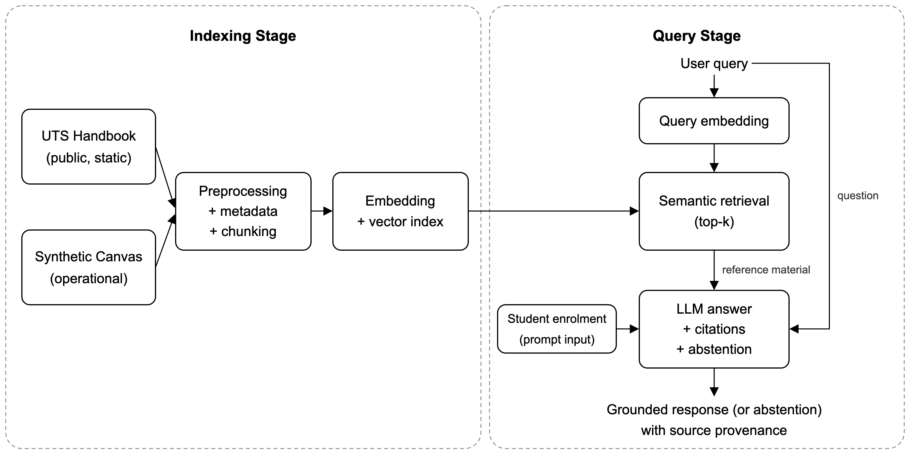

# RAG study assistant over UTS Handbook + Canvas content

A retrieval-augmented question answering pipeline for university subjects. A student question is
embedded, the most similar chunks are retrieved from a vector store that holds both **Handbook**
(official subject descriptions) and **Canvas** (synthetic LMS pages: assignments, modules,
announcements), and an LLM answers using only those chunks, cites its sources, and says so when
the material does not contain the answer.



## What the evaluation found

All numbers are from the 15-question benchmark in `benchmark/`, 3 generation runs per question.

- **Faithful but incomplete.** Faithfulness is 0.95, yet answers cover only 0.81 of the reference
  content. Q1 is the clearest case: the gold chunk was retrieved and cited, recall, faithfulness
  and citation support are all 1.0, but the answer states 3 of 7 learning outcomes
  (completeness 0.43). Faithfulness alone does not catch omissions, so a separate completeness
  metric was added (answer vs reference, item by item).
- **`top_k` 5 → 8 was the largest single change.** Gold chunk recall on Q1–10 went from 0.60 to
  0.93. Boosting chunks from the student's enrolled subjects added nothing on top of `k = 8`.
- **Abstention works on this benchmark.** Unanswerable questions were refused in 6/6 runs, and
  partially answerable ones got the correct partial answer in 9/9. Two of the ten answerable
  questions (Q3, Q9) were over-abstained in every run.
- **Swapping the embedding model moved the failures, not the score.** `bge-base-en-v1.5` and
  `e5-base-v2` miss different gold chunks (bge: Q9, Q10; e5: Q1, Q8, Q9), so bge was kept.
- **The LLM judge was audited, not trusted.** Asking the judge for an abstention label directly
  produced correct reasoning with the wrong label, so it now marks each requested item and the
  label is computed in code. Temperature 0 did not make generation or judging deterministic,
  which is why differences of about 0.02 are treated as noise.

## Limitations

- **15 questions, no dev/test split.** `top_k` and the system prompt were tuned on the same
  questions they are scored on, so the numbers are optimistic and one question moves a mean by
  up to 0.1.
- **Small corpus.** 638 chunks; retrieving 8 of them is an easy setting.
- **Synthetic Canvas data.** The 19 Canvas chunks were written for this project, so the
  cross-source results do not generalise to real course sites.
- **Dense retrieval only.** No keyword search and no reranker: subject abbreviations ("FSD")
  retrieve nothing, and id-based precision is 0.64.
- **No structured filtering.** Q10 ("what is due in Sep 2026?") needs a date filter that
  similarity search cannot provide; one gold chunk is missed.
- **English only, one judge model.**

## Layout

| Stage | File |
|---|---|
| Scrape subject records | `scrape_handbook.py` |
| Chunk Handbook records | `tag_handbook_record.py`, `tag_all.py` (`render_audit.py` checks that no rendered field is dropped) |
| Embed + store (Chroma) | `build_vector_store.py` |
| Retrieve + generate + cite | `rag_query.py` |
| Benchmark runner / scorer | `benchmark/run_eval.py`, `benchmark/score_eval.py` |
| Demo site (mock Canvas + assistant) | `demo_server.py`, `demo/` |

Configuration used for the results below: embedding `BAAI/bge-base-en-v1.5` (local), `top_k = 8`,
generation `gpt-4o-mini` at temperature 0, judge `gemini-3.1-flash-lite`.

## Quick start (no API key needed)

Needs **Python 3.10 or newer** (`chromadb` and `sentence-transformers` do not install on 3.9).
The demo site on its own is the exception: it is standard library only and runs on 3.9 too.

The vector store is already built (`chroma_db/`, 638 chunks: 96 Handbook subjects plus
Canvas pages for 4 of them), so retrieval runs without any key.

```bash
python3 -m venv venv && source venv/bin/activate
pip install -r requirements.txt
cp .env.example .env            # the embedding settings in it must stay as they are

python3 rag_query.py "What are the assessment tasks and due dates for Fundamentals of Software Development?" --show-retrieval-only
```

The first run downloads the embedding model (about 430 MB, needs internet, one time only).
`--show-retrieval-only` prints the retrieved chunk ids, their source type and section, and the
distances. It never calls the LLM.

## Demo site

A mock Canvas with the study assistant built into it — this is what was shown in the
presentation. Run it from inside the virtual environment created above:

```bash
python3 demo_server.py          # then open http://localhost:8000
```

The server itself uses only the standard library, so the site comes up even with no
packages installed and no API key: the subject pages are rendered from the same chunk
files that went into the vector store (`tagged_data/`, `canvas_synthetic/`), and a
citation in an answer links back to the page it came from.

Asking a question in the assistant panel calls the full pipeline, so that part needs the
installed requirements and `OPENAI_API_KEY` in `.env`. Without them the panel reports the
missing dependency instead of answering. Use `DEMO_PORT=8001 python3 demo_server.py` if
port 8000 is taken.

## Full answers (needs `OPENAI_API_KEY`)

Put your own key in `.env` (`OPENAI_API_KEY=...`) and drop `--show-retrieval-only`:

```bash
python3 rag_query.py "How many credit points is Fundamentals of Software Development, and what does it cover?"
```

Other options: `--top-k N`, `--source-type {handbook,canvas}`, `--single-query` (turns off the
automatic splitting of compound questions into sub-queries).

Questions should use full subject names, not abbreviations: the corpus does not contain
abbreviations, so retrieval cannot match them.

## Reading the saved answers without any key

The answers from the benchmark runs are saved, so they can be read without calling any API.
Each line of `answers.jsonl` is one (question, run) pair with the fields `id`, `question`,
`answer`, `contexts`, `retrieved_ids`, `gold_chunk_ids`, `reference`, `recall`.

```bash
cd benchmark/results/20261006_v3_k8_baseline
jq '.answer' answers.jsonl                                   # all answers
jq -r 'select(.run==1) | "Q\(.id): \(.question)\n\(.answer)\n"' answers.jsonl   # one run, with questions
jq '.configs.k8' summary.json                                # retrieval recall per question
jq '.configs.k8' score_summary_gemini-3.1-flash-lite_t0_a.json   # judged scores
```

## Benchmark

`benchmark/questions.json` holds 15 questions with reference answers and gold chunk ids:
5 single-source, 5 multi-source (Handbook + Canvas), 3 partially answerable, 2 unanswerable.

```bash
python3 benchmark/run_eval.py --runs 3 --config k8 top_k=8      # needs OPENAI_API_KEY
python3 benchmark/score_eval.py benchmark/results/<run_dir> --tag mine   # needs OPENAI_API_KEY + GEMINI_API_KEY
```

`run_eval.py` retrieves once per question and generates `--runs` times (temperature 0 still
gives different wording between runs). `score_eval.py` reads that run's `answers.jsonl` and
writes `scores_*.jsonl` and `score_summary_*.json` next to it; `--tag` is a filename suffix so a
re-scoring does not overwrite an earlier one.

### Result folders

| Folder | What it is |
|---|---|
| `20261006_v3_k8_baseline` | Final configuration, 15 questions x 3 runs. Judge scores are in the `*_t0_a` files (judge temperature 0) |
| `20261001_embed_bge_vs_e5` | Same questions, `bge-base-en-v1.5` vs `e5-base-v2` embeddings. Retrieval recall summary only |
| `20260928-0258_k5_vs_k8` | `top_k` 5 vs 8, an earlier prompt version. Retrieval recall summary only |

### Final results (`20261006_v3_k8_baseline`, `_t0_a` scoring)

| Metric | Value |
|---|---|
| Gold chunk recall / precision (id based) | 0.933 / 0.639 |
| Faithfulness (answerable questions) | 0.954 |
| Abstention success (unanswerable questions) | 1.00 |
| Over-abstention (answerable questions) | 0.20 |
| Citation support | 0.906 |
| Completeness vs reference (answerable) | 0.812 |
| Partial questions: correct partial abstention | 1.00 |

The judge model is not the generator, and judge output varies a little between scoring passes,
so treat differences of about 0.02 as noise.

## Rebuilding the vector store

```bash
python3 build_vector_store.py tagged_data/*_chunks.json canvas_synthetic/*_canvas_chunks.json
```

This deletes and recreates the `rag_mvp` collection in `chroma_db/`. The build and the query
must use the same `EMBEDDING_PROVIDER` / `LOCAL_EMBEDDING_MODEL`; `rag_query.py` stops with an
error if they differ from what is stored in the collection.

`tagged_data/` holds the already chunked Handbook records. The raw scrape (`handbook_data/`) is not included.

## Notes

- The Canvas content is **synthetic**: written for this project, not real course data. Its
  sources appear as `synthetic://...` in citations.
- "Enrolled subjects" are derived from the corpus: a subject with Canvas chunks counts as
  enrolled. The list is given to the prompt as context; it is not a hard retrieval filter.
- Never commit `.env`. It holds your API keys.
- Handbook content in `tagged_data/` was collected from the public UTS Handbook and remains the
  property of the University of Technology Sydney. It is included for research and educational
  use only.
